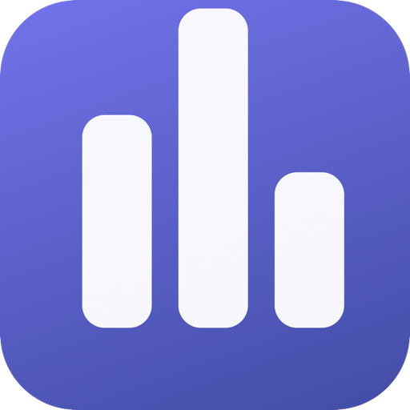
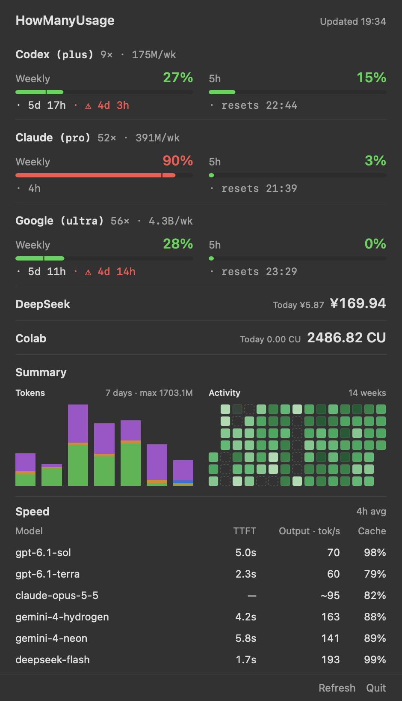

<div align="center">



# HowManyUsage

**A lightweight macOS menu bar monitor for your AI coding & compute quotas.**

[](https://github.com/rockcli/howmanyusage)
[](https://swift.org)
[](LICENSE)

English | [简体中文](README.zh-CN.md)

<br />



</div>

## Features

- 🔍 **Auto-detection** — Only shows providers installed on your Mac (CLI, desktop app, local config, or the `colab-operator` skill). Uninstalled tools stay hidden.
- 📊 **Quotas & forecasts** — Weekly/5-hour progress bars with today's burn marker, exhaustion warnings, unused-quota hints, burn-spike alerts, and API-equivalent plan value.
- 📈 **Summary & speed** — 7-day stacked token chart, 14-week activity heatmap, and 4-hour average model speed (`TTFT`, `Output tok/s`, `Cache %`).
- 🔒 **Local & read-only** — Reuses existing local login state and logs. Zero telemetry, zero external backend, never refreshes Claude OAuth tokens, and never writes or modifies any provider's on-disk credential files (Colab may perform an in-memory access-token refresh against Google's OAuth endpoint if expired).

## Supported Providers

| Provider | Auto-Detected Via | Source |
|----------|-------------------|--------|
| **Codex** | `codex` CLI, `Codex.app`, `~/.codex` | `chatgpt.com/backend-api/wham/usage` + local sessions |
| **Claude** | `claude` CLI, `Claude.app`, `~/.claude`, Claude Desktop config | `api.anthropic.com/api/oauth/usage` + local projects |
| **Google (Antigravity)** | `agy` / `antigravity`, `Antigravity.app`, `~/.gemini/antigravity*` | Local Antigravity daemon RPC + transcripts |
| **DeepSeek** | `dsh` / `pi`, `DeepSeek.app`, `DEEPSEEK_API_KEY` | `api.deepseek.com/user/balance` + local `pi`/`dsh` logs |
| **Colab** | `colab-operator` skill, `colab` CLI, `~/.config/colab-cli` | `colab.research.google.com/tun/m/ccu-info` |

## Quick Start

Requires **macOS 13+** and **Xcode Command Line Tools** (`xcode-select --install`).

```bash
git clone https://github.com/rockcli/howmanyusage.git
cd howmanyusage
./scripts/install.sh
```

`./scripts/install.sh` builds locally, installs `/Applications/HowManyUsage.app`, enables login autostart via LaunchAgent, and launches the menu bar icon.

**Uninstall:**

```bash
launchctl unload ~/Library/LaunchAgents/com.local.howmanyusage.plist
rm -f ~/Library/LaunchAgents/com.local.howmanyusage.plist
rm -rf /Applications/HowManyUsage.app
```

## CLI & Development

```bash
swift test --package-path app                # run unit tests
./app/.build/debug/HowManyUsage --once       # print one-shot text report
./app/.build/debug/HowManyUsage --speed      # print 4h model speed table
```

## Non-Goals

- **Not a credential manager or billing source of truth** — Never modifies on-disk provider credential files and never refreshes Claude OAuth tokens. DeepSeek/Colab spend inferred from observed balance drops is a lower bound that recharges or polling gaps can under-report.
- **No cloud sync or analytics backend** — All history, heatmaps, and speed telemetry remain on your Mac.

## Known Pitfalls

- **Unofficial endpoints & desktop storage formats** — Codex (`chatgpt.com/backend-api/wham/*`), Claude (`api.anthropic.com/api/oauth/usage`), Colab (`tun/m/ccu-info`), and Electron `safeStorage` (`v10`) are undocumented internals that may break when upstream apps update.
- **No Claude token refresh & multi-org fail-closed** — Expired Claude tokens report an auth error until refreshed by Claude Code or Claude Desktop; Claude Desktop profiles with multiple organizations fail closed instead of guessing.
- **Local daemon & binary preconditions** — Antigravity live quota requires the local daemon (`hub_*.json` + live PID); DSH `.jsonl.zstd` speed parsing requires `zstd` in `PATH`/Homebrew (silently skipped otherwise); `--claude-usage` CLI bucketing uses GMT+8. On macOS CommandLineTools 16.2/16.4 mismatches, `scripts/build-app.sh` falls back to direct `swiftc` with a VFS overlay.

## Security & Trust Boundaries

- **Zero macOS TCC input/screen permissions** — Requires no Accessibility, Input Monitoring, or Screen Recording permissions.
- **Local credential & Keychain access** — Reads `~/.codex/auth.json`, `~/.claude/.credentials.json` (only if file permissions satisfy `mode & 0o077 == 0`), shell rc files for `DEEPSEEK_API_KEY`, `~/.config/colab-cli/token.json`, loopback Antigravity `hub_*.json`, and invokes `/usr/bin/security find-generic-password` for `"Claude Code-credentials"` and `"Claude Safe Storage"` (used locally to decrypt Claude Desktop `config.json`).
- **Strictly direct provider egress** — Prompt/transcript contents, token totals, heatmaps, and speed metrics stay under `~/.config/howmanyusage/`. Only provider auth credentials (plus locally collected Codex conversation UUIDs for server-side attribution) are sent directly to each provider's HTTPS endpoint (or `127.0.0.1` for Antigravity) over an ephemeral `URLSession`.

## Disclaimer

All requests go directly from your Mac to each provider's endpoint using your local credentials. Some quota endpoints and desktop storage formats are unofficial/internal interfaces and may change with upstream updates.

## License

[MIT](LICENSE) © [rockcli](https://github.com/rockcli)
