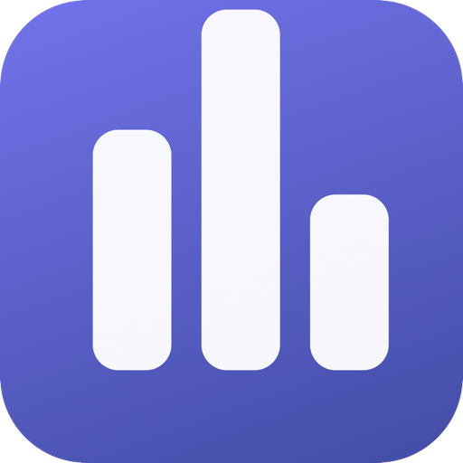
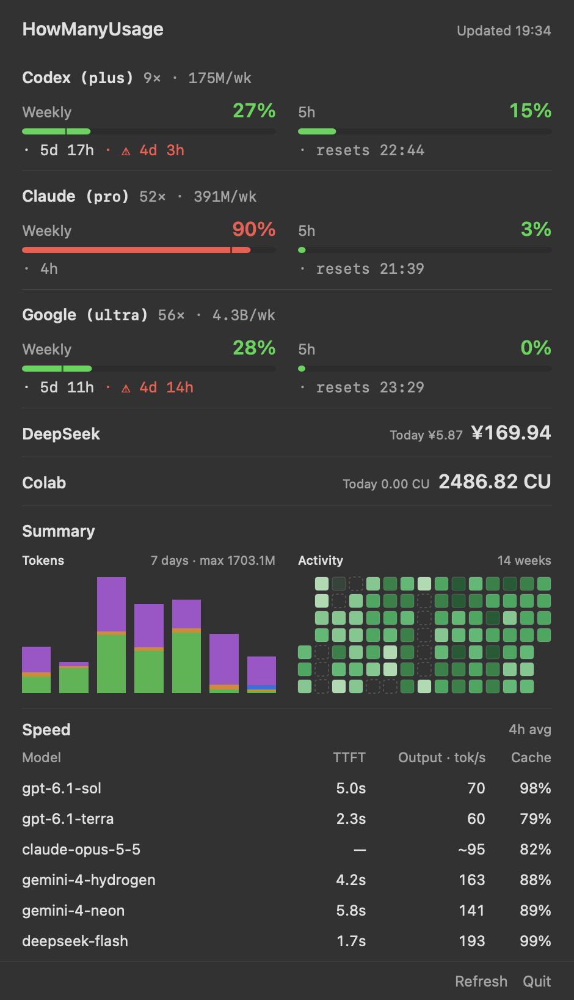

<div align="center">



# HowManyUsage

**轻量级 macOS 菜单栏工具，一站式监控你的 AI 编程与算力额度。**

[](https://github.com/rockcli/howmanyusage)
[](https://swift.org)
[](LICENSE)

[English](README.md) | 简体中文

<br />



</div>

## 核心特性

- 🔍 **自动探测本机工具** — 自动检测本机已安装的 CLI、桌面客户端、本地配置或 `colab-operator` 技能；未安装的工具自动隐藏，不显示空白占位。
- 📊 **额度与消耗预测** — 展示周额度 / 5 小时进度条、今日消耗分割线、耗尽预警、剩余额度提醒、短时突增告警以及按本地日志估算的订阅价值倍数。
- 📈 **汇总图表与模型测速** — 内置近 7 天分平台 Token 柱状图、14 周活跃度热力图，以及近 4 小时模型实测速度表（`TTFT`、`Output tok/s`、`Cache %`）。
- 🔒 **纯本地只读** — 复用各工具本机已有登录态与日志；无第三方服务器、无遥测上报，绝不刷新 Claude OAuth Token，也绝不改写任何平台的磁盘凭据文件（Colab 令牌过期时仅在内存向 Google OAuth 换取临时访问令牌，不回写磁盘）。

## 支持平台

| 平台 | 自动探测依据（CLI / 客户端 / 配置） | 数据来源 |
|------|------------------------------------|----------|
| **Codex** | `codex` CLI、`Codex.app`、`~/.codex` | `chatgpt.com/backend-api/wham/usage` + 本地会话日志 |
| **Claude** | `claude` CLI、`Claude.app`、`~/.claude`、Claude Desktop 配置 | `api.anthropic.com/api/oauth/usage` + 本地项目日志 |
| **Google (Antigravity)** | `agy` / `antigravity`、`Antigravity.app`、`~/.gemini/antigravity*` | 本地 Antigravity daemon RPC + 对话日志 |
| **DeepSeek** | `dsh` / `pi`、`DeepSeek.app`、`DEEPSEEK_API_KEY` | `api.deepseek.com/user/balance` + 本地 `pi`/`dsh` 日志 |
| **Colab** | `colab-operator` 技能、`colab` CLI、`~/.config/colab-cli` | `colab.research.google.com/tun/m/ccu-info` |

## 快速开始

环境要求：**macOS 13+** 与 **Xcode Command Line Tools**（`xcode-select --install`，无需安装完整 Xcode）。

```bash
git clone https://github.com/rockcli/howmanyusage.git
cd howmanyusage
./scripts/install.sh
```

`./scripts/install.sh` 会在本机编译 Release 版本、安装到 `/Applications/HowManyUsage.app`、配置 LaunchAgent 开机自启并启动菜单栏图标。

**卸载：**

```bash
launchctl unload ~/Library/LaunchAgents/com.local.howmanyusage.plist
rm -f ~/Library/LaunchAgents/com.local.howmanyusage.plist
rm -rf /Applications/HowManyUsage.app
```

## 命令行与开发

```bash
swift test --package-path app                # 运行单元测试
./app/.build/debug/HowManyUsage --once       # 终端打印单次用量报告
./app/.build/debug/HowManyUsage --speed      # 终端打印近 4 小时模型速度表
```

## 非目标

- **非凭据管家或权威账单系统** — 绝不改写任何平台的磁盘凭据文件，也不会刷新 Claude OAuth Token；DeepSeek / Colab 通过余额下降估算的消耗属于下界值，充值或采样间隔可能造成低估。
- **无云端同步或分析后台** — 所有历史记录、热力图与测速数据均仅保存在本机。

## 已知坑点

- **依赖非公开接口与本地存储格式** — Codex（`chatgpt.com/backend-api/wham/*`）、Claude（`api.anthropic.com/api/oauth/usage`）、Colab（`tun/m/ccu-info`）及 Electron `safeStorage`（`v10`）均属于上游内部格式，版本升级后可能失效。
- **不主动刷新 Claude Token 且多组织保守失败** — Claude Token 过期后需由 Claude Code 或 Claude Desktop 自行续期；若 Claude Desktop 配置包含多个组织，程序会 fail-closed 报错而不盲猜。
- **运行前置依赖与构建兜底** — Antigravity 实时额度依赖本地 daemon 存活（`hub_*.json` + 存活 PID）；解析 DSH `.jsonl.zstd` 需安装 `zstd` CLI（缺失时静默跳过）；`--claude-usage` CLI 当前按 GMT+8 切分日期；遇到 macOS CommandLineTools 16.2/16.4 SDK 错配时，`scripts/build-app.sh` 会自动回退为 `swiftc` + VFS overlay 编译。

## 安全与信任边界

- **零键盘/屏幕 TCC 权限** — 不申请辅助功能、输入监控或屏幕录制权限。
- **本地凭据与钥匙串读取范围** — 按需读取 `~/.codex/auth.json`、`~/.claude/.credentials.json`（严格校验权限 `mode & 0o077 == 0`）、Shell 配置文件中的 `DEEPSEEK_API_KEY`、`~/.config/colab-cli/token.json`、本地 Antigravity `hub_*.json`，并通过 `/usr/bin/security find-generic-password` 读取 `"Claude Code-credentials"` 与 `"Claude Safe Storage"`（仅在本地解密 Claude Desktop `config.json`）。
- **出境数据最小化且直连原厂** — 对话全文、Token 统计、热力图与测速记录均留存在 `~/.config/howmanyusage/`；仅对应平台的认证凭据（及 Codex 用于服务端归因查询的会话 UUID）会通过临时 `URLSession` 直连各自官方 HTTPS 接口（Antigravity 仅走 `127.0.0.1`）。

## 免责声明

所有请求均直接从本机发往对应平台接口，不经过任何中间服务。部分额度接口与客户端本地存储格式属于非公开/内部实现，可能随上游客户端更新而变化。

## 许可证

[MIT](LICENSE) © [rockcli](https://github.com/rockcli)
